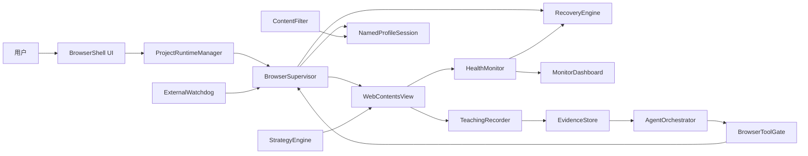

# 总体架构

> 状态：目标架构。Phase 0 工程基线已经落地，其余组件按 roadmap 逐步实现。

## 当前代码映射

已经存在：

- `src/main/index.ts`：`BaseWindow`、BrowserShell `WebContentsView`、远程页面布局和受信 IPC 注册。
- `src/main/browser-supervisor.ts`：Named Profile session、页面生命周期事件、导航/刷新、主动心跳探针和 renderer 消失后的重建入口。
- `src/main/checkpoint-store.ts`：版本化浏览器检查点、串行原子写入、读取校验和损坏文件隔离。
- `src/main/main-process-heartbeat.ts`：Electron main 的外部存活心跳。
- `src/main/watchdog.ts`：应用外进程监督、心跳超时、重启预算和状态记录。
- `src/main/phase0-probe-server.ts`：仅用于 smoke 的 frame、失败导航、Cookie 和阻塞探针页面。
- `src/main/navigation.ts`：仅允许 HTTP/HTTPS 的导航边界。
- `src/preload/index.ts`：最小 BrowserShell API。
- `src/preload/strategy-bootstrap.ts`：session 级 frame preload 的 Phase 0 注入探针。
- `src/renderer/`：Phase 0 BrowserShell、地址栏、刷新和生命周期事件面板。
- `src/shared/contracts.ts`：跨进程结构化契约。

尚未实现：

- 安装包 Watchdog 启动入口与系统开机启动集成。
- workflow/业务检查点、Strategy/Workflow/Project Runtime。
- Content Filter、Download Manager 和完整监控。
- 示教录制与 Agent sidecar。

目标架构章节描述的是完成后的组件边界；未实现能力不能按现有功能对外宣称。

## 系统边界

AgenticBrowser 自己拥有浏览器窗口、项目调度、策略运行、下载、监控和恢复。远程网页是零信任内容，只能通过受控页面能力与宿主交互。

## 进程与信任区

### 外部 Watchdog

- 独立于 Electron 生命周期。
- 只监控主进程心跳、记录退出原因并按预算重启。
- 不执行网页操作，也不保存业务密钥。

当前 Watchdog 是构建为 `out/main/watchdog.js` 的纯 Node 入口。它读取本机受信 JSON 配置，启动 Electron 子进程，并向子进程下发 launch ID、restart count 和 heartbeat 路径。main process 周期性原子更新 heartbeat；Watchdog 校验 PID、launch ID 和时间戳，启动宽限期后超时则强杀并按预算重启。Watchdog 自身将 phase、PID、启动次数、退出历史和预算状态原子写入状态文件。

Phase 0 smoke 已证明 Watchdog 与 Electron 是独立进程，强杀 main 后能重新启动。安装后的 launcher/sidecar 承载方式、Windows 登录启动和 macOS launchd/签名尚未落地。

### Electron 主进程

- 唯一拥有 `WebContentsView`、session、权限、下载和高权限 IPC 的进程。
- 运行 Project Runtime Manager、Browser Supervisor、Recovery Engine 和 Tool Gate。
- 持久化 workflow 检查点和幂等记录。

### BrowserShell renderer

- 只加载本地可信 UI。
- 展示项目、策略、过滤器、内嵌浏览器容器、运行抽屉和监控面板。
- 通过类型化、最小化 IPC 调用主进程，不直接获得 Node 或密钥。

### 远程页面 renderer

- `sandbox: true`
- `contextIsolation: true`
- `nodeIntegration: false`
- `nodeIntegrationInSubFrames: true`，仅用于让受沙箱约束的 preload 覆盖所有 frame。
- 与 BrowserShell renderer 分离。
- 只能运行经过项目授权的 Strategy 和页面探针。

session 使用 `registerPreloadScript({ type: "frame" })` 在 top frame、同源 iframe 和跨域 OOPIF 中安装 bootstrap。Electron 的 session frame preload 当前按 CommonJS 加载，因此构建产物固定为 `.cjs`；ESM 产物不能作为该注入链路的输入。

`nodeIntegrationInSubFrames` 扩大了 preload 的执行范围，但页面 main world 仍无 Node `process`、`require` 或原始 IPC。所有 frame 都被视为不可信：bootstrap 不得暴露文件、shell、密钥或通用 IPC，只能接受带 Project/Strategy 能力校验的窄接口。正式 Strategy 执行器还未实现，当前 bootstrap 只在 smoke 参数存在时写入无权限 marker。

### Agent sidecar/utility process

- 承载 CodeBuddy Agent SDK 和流式会话。
- 只通过结构化工具访问浏览器。
- SDK 密钥位于系统钥匙串或本机私密配置。

## 核心组件

### ProjectRuntimeManager

负责项目清单、命名 Profile、调度、并发上限、前后台切换和资源预算。主进程维护时间与超时，不依赖后台 renderer timer。

### BrowserSupervisor

负责创建、绑定、销毁和重建 `WebContentsView`；注册加载、无响应、崩溃、导航、权限和下载事件；将底层事件归一化成领域事件。

页面健康不能只依赖 Chromium 的 `unresponsive`/`responsive` 事件。这些事件触发较慢，并可能因页面隐藏或缺少用户输入而不触发。HealthMonitor 以主进程发起的短超时主动 ping、加载状态和业务断言为主信号；原生无响应事件只作为辅助证据。连续失败必须进入有预算的 RecoveryEngine，不能无限 reload。

成功导航后，BrowserSupervisor 将当前 URL 与 Profile ID 写入浏览器检查点。应用启动时先校验检查点，再用其中的 Profile 与 URL 创建页面。检查点损坏时隔离原文件并退回安全初始页，不能形成启动崩溃循环。

### StrategyEngine

根据 URL、frame 和 Project allowlist 选择固定版本 Strategy，在指定 `runAt` 执行。默认使用隔离 world；访问 main world 需要显式能力。

### WorkflowEngine

执行跨页面显式状态机。步骤包含前置条件、动作、成功断言、超时、幂等键、检查点和失败转移。

### RecoveryEngine

根据页面、子进程和业务健康信号选择恢复级别，实施重试预算和熔断。恢复详情见 [ADR-0003](../ADR/0003-deterministic-recovery-before-agent.md)。

### ContentFilter

中心化合并网络观测、阻断和下载需求。网络规则与页面 CSS 规则按项目启用，不使用通用 Chrome 扩展作为基础。

### TeachingRecorder

记录带单调时间戳的输入、URL、viewport、滚动位置、目标语义、DOM/Accessibility、网络摘要和关键帧。运行数据使用环形缓冲与变化抽帧。

### AgentOrchestrator

Agent 负责分析新状态、提出恢复动作或生成候选 workflow。Tool Gate 校验能力、参数、项目边界和风险等级，结构化结果是唯一控制协议。

## 状态与存储

持久化数据至少分为：

- 配置：Project、Strategy、Profile 引用、调度和权限。
- 运行状态：Runtime、workflow 检查点、幂等键和恢复预算。
- 业务记录：扫描项、下载元数据和处理状态。
- 证据：截图、DOM/AX 快照、网络摘要和故障时间线。
- 密钥：只存引用，真实值进入系统钥匙串或本机私密配置。

Profile/Cookie 使用 Electron session partition 存储，不提交仓库，也不进入项目导出包。

当前浏览器检查点 schema v1 只保存 `profileId`、URL、保存原因和时间，使用同目录临时文件加 rename 原子替换。这是 main process 重启恢复的最小切片；workflow 步骤、幂等键、下载事务和业务游标必须由 Phase 3 的 Project Runtime 独立持久化，不能塞入该文件冒充业务恢复。

## 可观测性

监控按层级区分：

- Watchdog/Electron main 与 App/Supervisor 心跳。
- Project Runtime 心跳与当前 workflow 步骤。
- Page 心跳、URL、加载和 renderer 状态。
- Strategy 心跳、执行时间、结果和错误。
- Chromium browser/renderer/GPU/utility 进程 CPU 与内存。

不能可靠归属到单个 Strategy 的资源消耗必须标记为共享，不能展示虚假的精确值。
