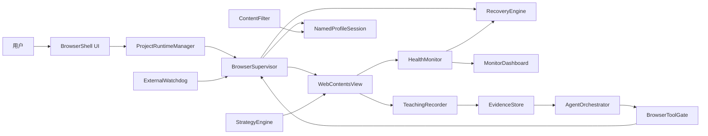

# 总体架构

> 状态：目标架构，Phase 0 尚未完成实现验证。

## 系统边界

AgenticBrowser 自己拥有浏览器窗口、项目调度、策略运行、下载、监控和恢复。远程网页是零信任内容，只能通过受控页面能力与宿主交互。

## 进程与信任区

### 外部 Watchdog

- 独立于 Electron 生命周期。
- 只监控主进程心跳、记录退出原因并按预算重启。
- 不执行网页操作，也不保存业务密钥。

### Electron 主进程

- 唯一拥有 `WebContentsView`、session、权限、下载和高权限 IPC 的进程。
- 运行 Project Runtime Manager、Browser Supervisor、Recovery Engine 和 Tool Gate。
- 持久化 workflow 检查点和幂等记录。

### BrowserShell renderer

- 只加载本地可信 UI。
- 展示项目、策略、过滤器、内嵌浏览器容器、运行抽屉和监控面板。
- 通过类型化、最小化 IPC 调用主进程，不直接获得 Node 或密钥。

### 远程页面 renderer

- `sandbox: true`
- `contextIsolation: true`
- `nodeIntegration: false`
- 与 BrowserShell renderer 分离。
- 只能运行经过项目授权的 Strategy 和页面探针。

### Agent sidecar/utility process

- 承载 CodeBuddy Agent SDK 和流式会话。
- 只通过结构化工具访问浏览器。
- SDK 密钥位于系统钥匙串或本机私密配置。

## 核心组件

### ProjectRuntimeManager

负责项目清单、命名 Profile、调度、并发上限、前后台切换和资源预算。主进程维护时间与超时，不依赖后台 renderer timer。

### BrowserSupervisor

负责创建、绑定、销毁和重建 `WebContentsView`；注册加载、无响应、崩溃、导航、权限和下载事件；将底层事件归一化成领域事件。

### StrategyEngine

根据 URL、frame 和 Project allowlist 选择固定版本 Strategy，在指定 `runAt` 执行。默认使用隔离 world；访问 main world 需要显式能力。

### WorkflowEngine

执行跨页面显式状态机。步骤包含前置条件、动作、成功断言、超时、幂等键、检查点和失败转移。

### RecoveryEngine

根据页面、子进程和业务健康信号选择恢复级别，实施重试预算和熔断。恢复详情见 [ADR-0003](../ADR/0003-deterministic-recovery-before-agent.md)。

### ContentFilter

中心化合并网络观测、阻断和下载需求。网络规则与页面 CSS 规则按项目启用，不使用通用 Chrome 扩展作为基础。

### TeachingRecorder

记录带单调时间戳的输入、URL、viewport、滚动位置、目标语义、DOM/Accessibility、网络摘要和关键帧。运行数据使用环形缓冲与变化抽帧。

### AgentOrchestrator

Agent 负责分析新状态、提出恢复动作或生成候选 workflow。Tool Gate 校验能力、参数、项目边界和风险等级，结构化结果是唯一控制协议。

## 状态与存储

持久化数据至少分为：

- 配置：Project、Strategy、Profile 引用、调度和权限。
- 运行状态：Runtime、workflow 检查点、幂等键和恢复预算。
- 业务记录：扫描项、下载元数据和处理状态。
- 证据：截图、DOM/AX 快照、网络摘要和故障时间线。
- 密钥：只存引用，真实值进入系统钥匙串或本机私密配置。

Profile/Cookie 使用 Electron session partition 存储，不提交仓库，也不进入项目导出包。

## 可观测性

监控按层级区分：

- App/Supervisor 心跳。
- Project Runtime 心跳与当前 workflow 步骤。
- Page 心跳、URL、加载和 renderer 状态。
- Strategy 心跳、执行时间、结果和错误。
- Chromium browser/renderer/GPU/utility 进程 CPU 与内存。

不能可靠归属到单个 Strategy 的资源消耗必须标记为共享，不能展示虚假的精确值。
