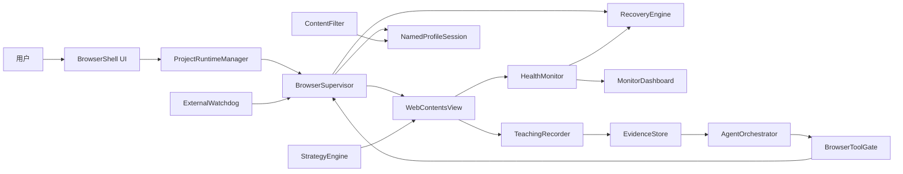

# 总体架构

> 状态：演进中。Phase 0 Windows 技术基线、Phase 1 监督浏览器、Phase 2 Strategy 与 Phase 3 核心 Runtime 已经落地；两个公开真实站点试点已通过，故障矩阵和外部门禁仍在进行。

## 当前代码映射

已经存在：

- `src/main/index.ts`：`BaseWindow`、BrowserShell `WebContentsView`、远程页面布局和受信 IPC 注册。
- `src/main/browser-supervisor.ts`：Named Profile session、页面生命周期事件、导航/刷新、主动心跳探针、人工接管时的 Strategy 暂停和 renderer 消失后的重建入口。
- `src/main/browser-tab-manager.ts`：最多 8 个独立 WebContents tab、活动 view 切换、全局事件序列和 session handler 所有权转移。
- `src/main/profile-store.ts`：版本化 Profile 清单、活动 Profile、串行原子更新和删除保护。
- `src/main/checkpoint-store.ts`：版本化浏览器检查点、串行原子写入、读取校验和损坏文件隔离。
- `src/main/capture-ring-buffer.ts`：受帧数与字节数双重约束、可冻结的内存截图环。
- `src/main/main-process-heartbeat.ts`：Electron main 的外部存活心跳。
- `src/main/watchdog.ts`：应用外进程监督、心跳超时、重启预算和状态记录。
- `src/main/health-monitor.ts`：短超时主动页面探针、连续失败阈值与恢复通知。
- `src/main/recovery-policy.ts`：时间窗预算、指数退避、分级恢复与熔断决策。
- `src/main/strategy-network.ts`：Strategy 宿主网络桥的边界规则，包括请求头禁止清单与 CRLF 注入拦截、响应头白名单、1 MiB 响应上限和重定向判定。
- `src/main/latency-stats.ts`：采样延迟的平均值、p95 与最大值统计。
- `src/main/monitor-snapshot.ts`：多 supervisor 与多 Project Runtime 的监控聚合，含隔离名单去重、下载计数求和和状态分类。
- `src/main/capability-store.ts`：版本化默认策略、精确 Origin 覆盖、旧配置迁移和能力解析。
- `src/main/strategy-match.ts`：HTTP(S) match/exclude、frame scope 和 Project allowlist 解析。
- `src/main/strategy-store.ts`：schema v1 Strategy manifest、严格校验、串行原子更新和损坏文件隔离。
- `src/main/strategy-policy-store.ts`：Phase 2 临时显式开发 allowlist；默认空列表并安全失败。
- `src/main/strategy-runtime.ts`：执行令牌、独立 world 分配、权限、宿主调用、心跳、超时和故障归因。
- `src/main/project-store.ts`：Project schema v1、固定 Strategy 版本、Profile/调度/workflow/输出/Filter 配置和原子存储。
- `src/main/project-runtime-store.ts`：持久化 Runtime 状态机、项目单实例、检查点、计数器、恢复和幂等记录。
- `src/main/project-scheduler.ts`：手动/自启/常驻/定时/恢复队列、时区、优先级、双槽预算、Profile 互斥和运行时长限制。
- `src/main/background-project-runtime.ts`：独立后台 BrowserTabManager、workflow、Strategy、下载事务、人工接管与终态生命周期。
- `src/main/project-workflow-engine.ts`：navigate/delay/wait-for-event/complete 状态机、重试、补偿转移、检查点和等待预算冻结/恢复。
- `src/main/project-download-manager.ts`：下载意图、临时文件、哈希、配额、原子提交、manifest 和业务去重。
- `src/main/project-download-recovery-smoke.ts` 与 `scripts/project-download-recovery-smoke.mjs`：下载部分写入时外部强杀 Electron main，并验证 Watchdog、Runtime 检查点、失败证据和无重复安全重试。
- `src/main/project-download-fault-smoke.ts` 与 `scripts/project-download-fault-smoke.mjs`：在 Electron session 内注入离线并中止已建立下载，同时验证磁盘配额预检拒绝、manifest、Runtime 计数和分类事件。
- `scripts/project-download-renderer-recovery-smoke.mjs`：下载部分写入时只强杀页面 renderer，验证 session DownloadItem 跨 view 重建继续传输、Strategy 重入去重和同 Runtime 完成。
- `src/main/project-item-store.ts`：项目业务项观测、matched/skipped 分类、跨 Runtime 去重和扫描计数。
- `src/main/automation-playground-pilot.ts`：默认禁用的双站点 Project/Strategy 模板、确定性页面断言、跨域延迟同步与测试文件下载。
- `src/main/content-filter.ts`：Project 网络资源规则和 CSS selector 规则。
- `src/main/structured-event-log.ts`：串行 JSONL 领域事件日志。
- `src/main/download-path.ts`：跨平台下载文件名清理。
- `src/main/phase0-probe-server.ts`：仅用于 smoke 的 frame、失败导航、Cookie 和阻塞页面夹具。
- `src/main/navigation.ts`：仅允许 HTTP/HTTPS 的导航边界。
- `src/preload/index.ts`：最小 BrowserShell API。
- `src/preload/strategy-bootstrap.ts`：单文件 session frame preload、run-at 调度和隔离 world bootstrap。
- `src/renderer/`：BrowserShell、地址栏、tabs、Profile、Project 工作台、Capability Center、Strategy 编辑/启停/allowlist、Runtime 监控和生命周期事件面板。
- `src/shared/contracts.ts`：跨进程结构化契约。

尚未实现或尚未完成：

- 两槽以上并发的资源压测与用户可配置预算；当前 Windows 验证预算固定为 2。
- 示教录制与 Agent sidecar。

目标架构章节描述的是完成后的组件边界；未实现能力不能按现有功能对外宣称。

## 系统边界

AgenticBrowser 自己拥有浏览器窗口、项目调度、策略运行、下载、监控和恢复。远程网页是零信任内容，只能通过受控页面能力与宿主交互。

## 进程与信任区

### 外部 Watchdog

- 独立于 Electron 生命周期。
- 只监控主进程心跳、记录退出原因并按预算重启。
- 不执行网页操作，也不保存业务密钥。

当前 Watchdog 是构建为 `out/main/watchdog.js` 的纯 Node 入口。它读取本机受信 JSON 配置，启动 Electron 子进程，并向子进程下发 launch ID、restart count 和 heartbeat 路径。main process 周期性原子更新 heartbeat；Watchdog 校验 PID、launch ID 和时间戳，启动宽限期后超时则强杀并按预算重启。Watchdog 自身将 phase、PID、启动次数、退出历史和预算状态原子写入状态文件。

打包应用被用户或系统登录项启动时，初始 Electron 进程只负责原子生成 userData/runtime 下的配置，然后用同一个打包可执行文件加 `ELECTRON_RUN_AS_NODE=1` 运行 app.asar 内的 Watchdog，成功 spawn 后立即退出。Watchdog 启动真正的 Electron 子进程前移除该环境变量。进程锁保证同一 userData 只有一个 Watchdog；Electron single-instance lock 再阻止重复应用实例。异常遗留的锁只有在记录 PID 已不存在时才会回收。

BrowserShell 可显式启停系统登录启动。Windows 登录项固定为当前打包可执行文件和 `--watchdog-autostart`；macOS 使用 Electron login item API。登录项仍从同一 launcher 进入，不会绕过 Watchdog。开发构建不允许修改系统登录项。

源码与 Windows `win-unpacked` smoke 均已证明强杀 main 后能从检查点重新启动；重复点击打包应用也被锁抑制。Windows smoke 对登录项只做 packaged 能力读取，没有修改系统设置或验证重启自启。macOS launcher、login item、签名和公证仍需真实 macOS runner 验证。

### Electron 主进程

- 唯一拥有 `WebContentsView`、session、权限、下载和高权限 IPC 的进程。
- 运行 Project Runtime Manager、Browser Supervisor、Recovery Engine 和 Tool Gate。
- 持久化 workflow 检查点和幂等记录。

### BrowserShell renderer

- 只加载本地可信 UI。
- 展示项目、策略、过滤器、内嵌浏览器容器、运行抽屉和监控面板。
- 通过类型化、最小化 IPC 调用主进程，不直接获得 Node 或密钥。

### 远程页面 renderer

- `sandbox: true`
- `contextIsolation: true`
- `nodeIntegration: false`
- `nodeIntegrationInSubFrames: true`，仅用于让受沙箱约束的 preload 覆盖所有 frame。
- `backgroundThrottling: false`，保证隐藏执行槽的健康探针、Strategy 心跳和 workflow timer 不因不可见而停摆。
- 与 BrowserShell renderer 分离。
- 只能运行经过项目授权的 Strategy 和页面探针。

session 使用 `registerPreloadScript({ type: "frame" })` 在 top frame、同源 iframe 和跨域 OOPIF 中安装 bootstrap。Electron 的 session frame preload 当前按 CommonJS 加载，并且沙箱/OOPIF 无法解析 Vite 拆出的相对共享 chunk，因此构建产物必须是独立单文件 `.cjs`。只有带受控启动参数的页面才会建立 Strategy IPC，防止共享 session 中的辅助 WebContents 误接入。

`nodeIntegrationInSubFrames` 扩大了 preload 的执行范围，但页面 main world 与 Strategy isolated world 均无 Node `process`、`require` 或原始 IPC。bootstrap 先通过 frame 绑定的同步握手取得已匹配定义和不可猜测执行令牌，再为每个 Strategy 建立独立 world；后续宿主调用必须同时通过 WebContents、frame、令牌、Strategy 权限和 URL allowlist 校验。远程页面拿不到 bridge，Strategy 也拿不到文件、shell、密钥或通用 IPC。

### Agent sidecar/utility process

- 承载 CodeBuddy Agent SDK 和流式会话。
- 只通过结构化工具访问浏览器。
- SDK 密钥位于系统钥匙串或本机私密配置。

## 核心组件

### ProjectRuntimeManager

负责项目清单、命名 Profile、调度、并发上限、前后台切换和资源预算。主进程维护时间与超时，不依赖后台 renderer timer。当前前台主槽和一个隐藏后台槽可以并行运行不同 Profile；共享 Profile 的 Project 由 Scheduler 互斥排队。选择运行中的 Project 会切换对应 view，可见性不改变后台执行状态。

Project 与 Runtime 使用独立的 schema v1 注册表。每个 Runtime 持有 Project 完整快照和固定 Strategy 版本；应用启动时把中断状态恢复成 queued，并从最后 workflow 检查点重新进入。Scheduler 支持 manual、autostart、resident、schedule 和 resume，daily 调度使用 IANA 时区，interval 调度从项目更新时间或上次定时运行计算。

全局并发预算当前固定为 2。前台槽与隐藏后台槽分别拥有独立 BrowserTabManager、Capability、Filter、Strategy 和下载上下文；不同 Profile 可并行，共享 Profile 由 Scheduler 互斥排队。事件带 Project/Runtime 归属，全局监控聚合两个槽。详见 [ADR-0006](../ADR/0006-persistent-project-runtime-and-download-intent.md)。

用户可在 workflow 稳定等待时执行“暂停并接管”。Runtime 进入 `paused`，等待预算冻结，当前 view 以相同 Profile 和 URL 重建为无 Strategy 页面；该 Runtime 仍占用执行槽和 Profile 锁。恢复时先还原等待态，再重建并注入固定版本 Strategy。Cookie、LocalStorage 与登录态保留，未持久化 DOM 状态不保证保留；进程重启后的 paused Runtime 由用户显式恢复并从最近检查点重新排队。详见 [ADR-0007](../ADR/0007-manual-takeover-pauses-automation.md)。

### BrowserSupervisor

负责创建、绑定、销毁和重建 `WebContentsView`；注册加载、无响应、崩溃、导航、权限和下载事件；将底层事件归一化成领域事件。

页面健康不能只依赖 Chromium 的 `unresponsive`/`responsive` 事件。这些事件触发较慢，并可能因页面隐藏或缺少用户输入而不触发。HealthMonitor 以主进程发起的短超时主动 ping、加载状态和业务断言为主信号；原生无响应事件只作为辅助证据。连续失败必须进入有预算的 RecoveryEngine，不能无限 reload。

当前 HealthMonitor 每秒由主进程探测页面，单次 500 ms 超时，连续三次失败才触发恢复。RecoveryPolicy 在 60 秒时间窗内最多执行四次：普通 reload、忽略缓存 reload、清 session cache 后 reload、重建 view；renderer 消失直接从重建级别开始。失败继续发生时打开 circuit、隐藏远程 view，并由 BrowserShell 显示本地错误页。用户显式导航或刷新会重置预算。

成功导航后，BrowserSupervisor 将当前 URL 与 Profile ID 写入浏览器检查点。应用启动时先校验检查点，再用其中的 Profile 与 URL 创建页面。检查点损坏时隔离原文件并退回安全初始页，不能形成启动崩溃循环。

BrowserTabManager 为每个 tab 持有独立 BrowserSupervisor/WebContentsView；非活动 view 保持存活但不可见，仍接受健康监督。所有 tab 共享同一命名 Profile session 和 capability 配置。session 下载 listener 始终只有一个所有者；permission handler 也记录最后注册的所有者。关闭对应所有者 tab 时先把 handler 转移到另一个 tab，避免重复处理、失去下载或继续引用已销毁 supervisor。浏览器检查点当前只保存最近激活 tab，不保存完整 tab 集合。

BrowserShell 可创建、激活和删除 Profile。激活时主进程销毁旧 BrowserTabManager，在目标命名 session 中以最近活动 URL 重建首个 tab，成功后才持久化活动 Profile；创建失败则重建并恢复原 Profile。Profile 切换、tab、导航、刷新和能力修改通过同一主进程队列串行化，避免操作落到已销毁的 manager。默认 Profile、活动 Profile 和被 Project 引用的 Profile 均不可删除；删除其他 Profile 时同时清理其 session storage、HTTP cache 和 auth cache。Project Runtime 启动时自动切换到快照绑定的 Profile。

### StrategyEngine

根据 URL、frame 和 Project allowlist 选择固定版本 Strategy，在指定 `runAt` 执行。默认使用隔离 world；访问 main world 需要显式能力。

schema v1 清单固化 `matches`、`excludes`、`runAt`、`frames`、权限、网络 allowlist、JSON 配置和启动/心跳超时。注册表最多保存 256 个 Strategy，拒绝未知字段、未知权限、重复匹配项、非 JSON 配置和过大的源码；写入使用串行原子替换，损坏文件会隔离。Strategy 必须同时处于启用状态、出现在当前运行上下文的显式 allowlist 中且命中 HTTP(S) URL 才会执行。开发态仍使用默认空的 `developmentAllowedStrategyIds`；Project Runtime 则从快照解析固定版本并取代开发 allowlist，缺失、版本不符或禁用均拒绝启动。

preload 按 `document-start`、`document-end` 或 `document-idle` 在每个匹配 frame 调度源码；配置只在声明 `config.read` 后注入。日志、领域事件、特权跨域网络请求和宿主 main-world 执行都经过主进程权限检查。宿主请求逐跳检查 `networkMatches`，拒绝敏感请求头、超限 body/response 和重定向逃逸；页面原生 `fetch`/XHR 仍按普通网页的 Origin/CORS/CSP 规则工作。`main-world` 同样只约束宿主桥，不能阻止拥有 DOM 写能力的脚本自行插入页面脚本。保存、启停或 allowlist 变化会重建受控 view，以清除旧监听器和 timer 后重新匹配。

主进程跟踪 starting/running/failed 与心跳。异常或超时 Strategy 会被当前 Supervisor 隔离，并通过强制终止 renderer 清除其同步死循环，再由既有 RecoveryEngine 重建页面；新页面不再注入被隔离 ID。Chromium 无法安全地只终止占住 renderer 主线程的单个 DOM isolated world，因此不能宣称有单脚本进程级抢占。

该信任边界、热重载与故障终止决策见 [ADR-0005](../ADR/0005-isolated-strategy-runtime.md)。

### WorkflowEngine

执行跨页面显式状态机。schema v1 节点包括 navigate、delay、wait-for-event 和 complete；每个节点包含超时、最大尝试次数、可选幂等键、检查点和按失败分类的补偿转移。Strategy 领域事件由主进程直接送入当前 Engine，不能从页面任意改写 Runtime。

Runtime 变更在每一步前后持久化。等待和指数退避由主进程 ticker 唤醒；人工接管会冻结剩余等待时间，恢复后继续计时；应用退出后从最近 checkpoint 节点恢复。更丰富的页面断言、分支和业务动作仍属于后续 schema。

### RecoveryEngine

根据页面、子进程和业务健康信号选择恢复级别，实施重试预算和熔断。恢复详情见 [ADR-0003](../ADR/0003-deterministic-recovery-before-agent.md)。

### ContentFilter

网络规则与页面 CSS 规则按 Project 快照启用，不使用通用 Chrome 扩展作为基础。allow 规则优先于 block；MVP 只阻断声明的子资源类型，不阻断主文档、subframe、WebSocket 或下载。CSS 规则按 URL 注入 selector 隐藏样式，所有命中都发布结构化事件。

### Capability Center 与 Download Manager

Capability Policy schema v1 保存 popup、download、notification、geolocation、media、clipboard-read 和 fullscreen 的完整默认值，以及最多 256 个精确 HTTP(S) Origin 覆盖。规则不支持通配符或隐式子域继承；非 HTTP(S)、不透明来源和未知权限一律拒绝。Chromium 权限按 requesting/security origin 判断，弹窗按 opener 页面 Origin 判断，下载按发起 WebContents Origin 判断。远程页面不能读取或修改策略；BrowserShell 经受信 IPC 更新完整策略。设计依据见 [ADR-0004](../ADR/0004-exact-origin-capability-policy.md)。

开发态 Capability 文件仍提供默认运行上下文；Project Runtime 启动后使用 Project 快照自己的默认值和精确 Origin 规则，终态后恢复开发配置。

session 级 `will-download` 统一接管下载。Project Strategy 必须先发送包含业务项、附件、来源 URL、文件名和预期大小的 `download.intent`；宿主完成权限、配额、磁盘与幂等检查后才允许对应下载。预检不足会返回 `rejected`，以 `failed/disk` 写入 manifest、原子增加 Runtime 失败计数并投递 `download.failed`，同一 Runtime/节点的重复 Strategy 注入复用同一拒绝记录。文件先写入项目 `tmp/`，完成后计算 SHA-256 并无覆盖提交到 `downloads/`，完整记录写入 `records/downloads.json`。相同业务附件再次出现时返回 completed 记录，不生成第二个文件。多个附件的完成回调按宿主队列串行提交，只有同一 Runtime 不再存在 reserved/downloading 记录时才发送聚合完成事件；若页面导航打断预留与下载触发之间的窗口，后续 Strategy 注入可识别仍在宿主待处理队列中的预留项并继续触发。网络中断同样先持久化 `failed/network` 和计数，再由 workflow 处理分类事件；故障注入诊断会将 Profile session 置为 offline，并显式中止已建立的 DownloadItem，因为 Chromium 的离线仿真本身不会终止已经建立的传输连接。

页面扫描通过 `project.item-observed` 报告业务项。宿主把文本、分类、附件摘要和来源写入 `records/items.json`，按 Project + 业务 ID 跨 Runtime 合并，并以原子计数更新 Runtime 的 scanned/matched/skipped。认证失效和已识别的页面结构变化由宿主转换为带分类的人工接管请求，页面脚本不能直接更改 Runtime 状态。

### TeachingRecorder

记录带单调时间戳的输入、URL、viewport、滚动位置、目标语义、DOM/Accessibility、网络摘要和关键帧。运行数据使用环形缓冲与变化抽帧。

当前 Phase 0 只实现了录制底座中的内存截图环：按最大帧数与最大字节数淘汰最旧 JPEG，并可在故障发生时冻结，冻结后拒绝新帧覆盖证据。输入轨迹、变化抽帧、DOM/AX、网络摘要、证据落盘和清理策略仍属于 Phase 4。

### AgentOrchestrator

Agent 负责分析新状态、提出恢复动作或生成候选 workflow。Tool Gate 校验能力、参数、项目边界和风险等级，结构化结果是唯一控制协议。

## 状态与存储

持久化数据至少分为：

- 配置：Project、Strategy、Profile 引用、调度和权限。
- 运行状态：Runtime、workflow 检查点、幂等键和恢复预算。
- 业务记录：扫描项、下载元数据和处理状态。
- 证据：截图、DOM/AX 快照、网络摘要和故障时间线。
- 密钥：只存引用，真实值进入系统钥匙串或本机私密配置。

Profile/Cookie 使用 Electron session partition 存储，不提交仓库，也不进入项目导出包。

Profile 清单保存在 userData 下的版本化 JSON 文件，使用临时文件加 rename 原子替换；并发修改由单进程队列串行化。Profile ID 只用于命名 session partition，显示名称不能直接成为目录或 partition 标识。

浏览器检查点 schema v1 只保存 `profileId`、URL、保存原因和时间，使用同目录临时文件加 rename 原子替换。业务恢复由独立的 Project Runtime Store 保存 Runtime 快照、workflow 节点、检查点、计数器和幂等记录；下载事务另存项目目录下的 manifest，不塞入浏览器检查点。

## 可观测性

监控按层级区分：

- Watchdog/Electron main 与 App/Supervisor 心跳。
- Project Runtime 心跳与当前 workflow 步骤。
- Page 心跳、URL、加载和 renderer 状态。
- Strategy 心跳、执行时间、结果和错误。
- Chromium browser/renderer/GPU/utility 进程 CPU 与内存。

不能可靠归属到单个 Strategy 的资源消耗必须标记为共享，不能展示虚假的精确值。

当前 BrowserShell 每两秒读取 `app.getAppMetrics()`，展示 Chromium 进程数、总 CPU、总工作集、页面健康、恢复状态、下载汇总、活跃/暂停/排队项目数和当前 Project Runtime。Project 工作台另展示持久化 Runtime 历史、当前 workflow 节点、检查点、计数器、Strategy 版本解析以及暂停/恢复操作。浏览器领域事件同时保留最近 500 条内存窗口，并串行追加到 userData 下的 JSONL 日志；Scheduler 队列/槽位的独立可视化、日志轮转和长期保留尚未实现。
