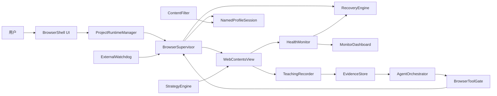

# 总体架构

> 状态：演进中。Phase 0 Windows 技术基线和 Phase 1 监督浏览器已经落地，Phase 2 Strategy 正在实现，其余组件按 roadmap 逐步推进。

## 当前代码映射

已经存在：

- `src/main/index.ts`：`BaseWindow`、BrowserShell `WebContentsView`、远程页面布局和受信 IPC 注册。
- `src/main/browser-supervisor.ts`：Named Profile session、页面生命周期事件、导航/刷新、主动心跳探针和 renderer 消失后的重建入口。
- `src/main/browser-tab-manager.ts`：最多 8 个独立 WebContents tab、活动 view 切换、全局事件序列和 session handler 所有权转移。
- `src/main/profile-store.ts`：版本化 Profile 清单、活动 Profile、串行原子更新和删除保护。
- `src/main/checkpoint-store.ts`：版本化浏览器检查点、串行原子写入、读取校验和损坏文件隔离。
- `src/main/capture-ring-buffer.ts`：受帧数与字节数双重约束、可冻结的内存截图环。
- `src/main/main-process-heartbeat.ts`：Electron main 的外部存活心跳。
- `src/main/watchdog.ts`：应用外进程监督、心跳超时、重启预算和状态记录。
- `src/main/health-monitor.ts`：短超时主动页面探针、连续失败阈值与恢复通知。
- `src/main/recovery-policy.ts`：时间窗预算、指数退避、分级恢复与熔断决策。
- `src/main/capability-store.ts`：版本化默认策略、精确 Origin 覆盖、旧配置迁移和能力解析。
- `src/main/strategy-match.ts`：HTTP(S) match/exclude、frame scope 和 Project allowlist 解析。
- `src/main/strategy-store.ts`：schema v1 Strategy manifest、严格校验、串行原子更新和损坏文件隔离。
- `src/main/structured-event-log.ts`：串行 JSONL 领域事件日志。
- `src/main/download-path.ts`：跨平台下载文件名清理。
- `src/main/phase0-probe-server.ts`：仅用于 smoke 的 frame、失败导航、Cookie 和阻塞探针页面。
- `src/main/navigation.ts`：仅允许 HTTP/HTTPS 的导航边界。
- `src/preload/index.ts`：最小 BrowserShell API。
- `src/preload/strategy-bootstrap.ts`：session 级 frame preload 的 Phase 0 注入探针。
- `src/renderer/`：BrowserShell、地址栏、tabs、Profile、Capability Center、监控和生命周期事件面板。
- `src/shared/contracts.ts`：跨进程结构化契约。

尚未实现：

- Strategy 隔离执行器、GM API、心跳、热重载和编辑 UI。
- workflow/业务检查点、Workflow/Project Runtime。
- Content Filter、Download Manager 和完整监控。
- 示教录制与 Agent sidecar。

目标架构章节描述的是完成后的组件边界；未实现能力不能按现有功能对外宣称。

## 系统边界

AgenticBrowser 自己拥有浏览器窗口、项目调度、策略运行、下载、监控和恢复。远程网页是零信任内容，只能通过受控页面能力与宿主交互。

## 进程与信任区

### 外部 Watchdog

- 独立于 Electron 生命周期。
- 只监控主进程心跳、记录退出原因并按预算重启。
- 不执行网页操作，也不保存业务密钥。

当前 Watchdog 是构建为 `out/main/watchdog.js` 的纯 Node 入口。它读取本机受信 JSON 配置，启动 Electron 子进程，并向子进程下发 launch ID、restart count 和 heartbeat 路径。main process 周期性原子更新 heartbeat；Watchdog 校验 PID、launch ID 和时间戳，启动宽限期后超时则强杀并按预算重启。Watchdog 自身将 phase、PID、启动次数、退出历史和预算状态原子写入状态文件。

打包应用被用户或系统登录项启动时，初始 Electron 进程只负责原子生成 userData/runtime 下的配置，然后用同一个签名可执行文件加 `ELECTRON_RUN_AS_NODE=1` 运行 app.asar 内的 Watchdog，成功 spawn 后立即退出。Watchdog 启动真正的 Electron 子进程前移除该环境变量。进程锁保证同一 userData 只有一个 Watchdog；Electron single-instance lock 再阻止重复应用实例。异常遗留的锁只有在记录 PID 已不存在时才会回收。

BrowserShell 可显式启停系统登录启动。Windows 登录项固定为当前打包可执行文件和 `--watchdog-autostart`；macOS 使用 Electron login item API。登录项仍从同一 launcher 进入，不会绕过 Watchdog。开发构建不允许修改系统登录项。

源码与 Windows `win-unpacked` smoke 均已证明强杀 main 后能从检查点重新启动；重复点击打包应用也被锁抑制。macOS launcher、login item、签名和公证仍需真实 macOS runner 验证。

### Electron 主进程

- 唯一拥有 `WebContentsView`、session、权限、下载和高权限 IPC 的进程。
- 运行 Project Runtime Manager、Browser Supervisor、Recovery Engine 和 Tool Gate。
- 持久化 workflow 检查点和幂等记录。

### BrowserShell renderer

- 只加载本地可信 UI。
- 展示项目、策略、过滤器、内嵌浏览器容器、运行抽屉和监控面板。
- 通过类型化、最小化 IPC 调用主进程，不直接获得 Node 或密钥。

### 远程页面 renderer

- `sandbox: true`
- `contextIsolation: true`
- `nodeIntegration: false`
- `nodeIntegrationInSubFrames: true`，仅用于让受沙箱约束的 preload 覆盖所有 frame。
- 与 BrowserShell renderer 分离。
- 只能运行经过项目授权的 Strategy 和页面探针。

session 使用 `registerPreloadScript({ type: "frame" })` 在 top frame、同源 iframe 和跨域 OOPIF 中安装 bootstrap。Electron 的 session frame preload 当前按 CommonJS 加载，因此构建产物固定为 `.cjs`；ESM 产物不能作为该注入链路的输入。

`nodeIntegrationInSubFrames` 扩大了 preload 的执行范围，但页面 main world 仍无 Node `process`、`require` 或原始 IPC。所有 frame 都被视为不可信：bootstrap 不得暴露文件、shell、密钥或通用 IPC，只能接受带 Project/Strategy 能力校验的窄接口。正式 Strategy 执行器还未实现，当前 bootstrap 只在 smoke 参数存在时写入无权限 marker。

### Agent sidecar/utility process

- 承载 CodeBuddy Agent SDK 和流式会话。
- 只通过结构化工具访问浏览器。
- SDK 密钥位于系统钥匙串或本机私密配置。

## 核心组件

### ProjectRuntimeManager

负责项目清单、命名 Profile、调度、并发上限、前后台切换和资源预算。主进程维护时间与超时，不依赖后台 renderer timer。

### BrowserSupervisor

负责创建、绑定、销毁和重建 `WebContentsView`；注册加载、无响应、崩溃、导航、权限和下载事件；将底层事件归一化成领域事件。

页面健康不能只依赖 Chromium 的 `unresponsive`/`responsive` 事件。这些事件触发较慢，并可能因页面隐藏或缺少用户输入而不触发。HealthMonitor 以主进程发起的短超时主动 ping、加载状态和业务断言为主信号；原生无响应事件只作为辅助证据。连续失败必须进入有预算的 RecoveryEngine，不能无限 reload。

当前 HealthMonitor 每秒由主进程探测页面，单次 500 ms 超时，连续三次失败才触发恢复。RecoveryPolicy 在 60 秒时间窗内最多执行四次：普通 reload、忽略缓存 reload、清 session cache 后 reload、重建 view；renderer 消失直接从重建级别开始。失败继续发生时打开 circuit、隐藏远程 view，并由 BrowserShell 显示本地错误页。用户显式导航或刷新会重置预算。

成功导航后，BrowserSupervisor 将当前 URL 与 Profile ID 写入浏览器检查点。应用启动时先校验检查点，再用其中的 Profile 与 URL 创建页面。检查点损坏时隔离原文件并退回安全初始页，不能形成启动崩溃循环。

BrowserTabManager 为每个 tab 持有独立 BrowserSupervisor/WebContentsView；非活动 view 保持存活但不可见，仍接受健康监督。所有 tab 共享同一命名 Profile session 和 capability 配置。session 下载 listener 始终只有一个所有者；permission handler 也记录最后注册的所有者。关闭对应所有者 tab 时先把 handler 转移到另一个 tab，避免重复处理、失去下载或继续引用已销毁 supervisor。浏览器检查点当前只保存最近激活 tab，不保存完整 tab 集合。

BrowserShell 可创建、激活和删除 Profile。激活时主进程销毁旧 BrowserTabManager，在目标命名 session 中以最近活动 URL 重建首个 tab，成功后才持久化活动 Profile；创建失败则重建并恢复原 Profile。Profile 切换、tab、导航、刷新和能力修改通过同一主进程队列串行化，避免操作落到已销毁的 manager。默认 Profile 和活动 Profile 不可删除；删除其他 Profile 时同时清理其 session storage、HTTP cache 和 auth cache。Project 模型尚未落地，因此被 Project 引用的 Profile 删除保护仍属于 Phase 3。

### StrategyEngine

根据 URL、frame 和 Project allowlist 选择固定版本 Strategy，在指定 `runAt` 执行。默认使用隔离 world；访问 main world 需要显式能力。

当前 schema v1 清单已固化 `matches`、`excludes`、`runAt`、`frames`、权限、网络 allowlist、JSON 配置和启动/心跳超时。注册表最多保存 256 个 Strategy，拒绝未知字段、未知权限、重复匹配项、非 JSON 配置和过大的源码；写入使用串行原子替换，损坏文件会隔离。匹配器只接受 HTTP(S)，并且 Strategy 必须同时处于启用状态、出现在显式 Project allowlist 中且命中 URL 才会被选择。Project 实体尚未落地，当前只提供解析边界，不能把它描述为已经能够执行脚本。

### WorkflowEngine

执行跨页面显式状态机。步骤包含前置条件、动作、成功断言、超时、幂等键、检查点和失败转移。

### RecoveryEngine

根据页面、子进程和业务健康信号选择恢复级别，实施重试预算和熔断。恢复详情见 [ADR-0003](../ADR/0003-deterministic-recovery-before-agent.md)。

### ContentFilter

中心化合并网络观测、阻断和下载需求。网络规则与页面 CSS 规则按项目启用，不使用通用 Chrome 扩展作为基础。

### Capability Center 与 Download Manager

Capability Policy schema v1 保存 popup、download、notification、geolocation、media、clipboard-read 和 fullscreen 的完整默认值，以及最多 256 个精确 HTTP(S) Origin 覆盖。规则不支持通配符或隐式子域继承；非 HTTP(S)、不透明来源和未知权限一律拒绝。Chromium 权限按 requesting/security origin 判断，弹窗按 opener 页面 Origin 判断，下载按发起 WebContents Origin 判断。远程页面不能读取或修改策略；BrowserShell 经受信 IPC 更新完整策略。设计依据见 [ADR-0004](../ADR/0004-exact-origin-capability-policy.md)。

当前策略文件仍属于应用运行上下文。Phase 3 创建 Project 后，Project Runtime 必须提供 Project 自己的默认值和 Origin 规则，不能继续把所有项目合并到这一个文件。

session 级 `will-download` 统一接管下载。禁止时立即取消；允许时清理路径分隔符、Windows 非法字符与设备保留名，再写入 Profile 下载目录。Phase 1 只维护 active/completed/failed/bytes 汇总；临时目录、原子完成、哈希、业务幂等和 manifest 属于 Phase 3。

### TeachingRecorder

记录带单调时间戳的输入、URL、viewport、滚动位置、目标语义、DOM/Accessibility、网络摘要和关键帧。运行数据使用环形缓冲与变化抽帧。

当前 Phase 0 只实现了录制底座中的内存截图环：按最大帧数与最大字节数淘汰最旧 JPEG，并可在故障发生时冻结，冻结后拒绝新帧覆盖证据。输入轨迹、变化抽帧、DOM/AX、网络摘要、证据落盘和清理策略仍属于 Phase 4。

### AgentOrchestrator

Agent 负责分析新状态、提出恢复动作或生成候选 workflow。Tool Gate 校验能力、参数、项目边界和风险等级，结构化结果是唯一控制协议。

## 状态与存储

持久化数据至少分为：

- 配置：Project、Strategy、Profile 引用、调度和权限。
- 运行状态：Runtime、workflow 检查点、幂等键和恢复预算。
- 业务记录：扫描项、下载元数据和处理状态。
- 证据：截图、DOM/AX 快照、网络摘要和故障时间线。
- 密钥：只存引用，真实值进入系统钥匙串或本机私密配置。

Profile/Cookie 使用 Electron session partition 存储，不提交仓库，也不进入项目导出包。

Profile 清单保存在 userData 下的版本化 JSON 文件，使用临时文件加 rename 原子替换；并发修改由单进程队列串行化。Profile ID 只用于命名 session partition，显示名称不能直接成为目录或 partition 标识。

当前浏览器检查点 schema v1 只保存 `profileId`、URL、保存原因和时间，使用同目录临时文件加 rename 原子替换。这是 main process 重启恢复的最小切片；workflow 步骤、幂等键、下载事务和业务游标必须由 Phase 3 的 Project Runtime 独立持久化，不能塞入该文件冒充业务恢复。

## 可观测性

监控按层级区分：

- Watchdog/Electron main 与 App/Supervisor 心跳。
- Project Runtime 心跳与当前 workflow 步骤。
- Page 心跳、URL、加载和 renderer 状态。
- Strategy 心跳、执行时间、结果和错误。
- Chromium browser/renderer/GPU/utility 进程 CPU 与内存。

不能可靠归属到单个 Strategy 的资源消耗必须标记为共享，不能展示虚假的精确值。

当前 BrowserShell 每两秒读取 `app.getAppMetrics()`，展示 Chromium 进程数、总 CPU、总工作集、页面健康、恢复状态和下载汇总。浏览器领域事件同时保留最近 500 条内存窗口，并串行追加到 userData 下的 JSONL 日志；日志轮转和长期保留尚未实现。
